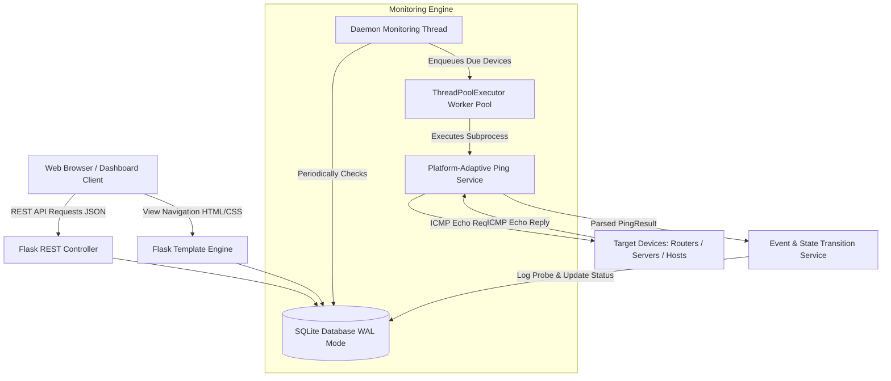
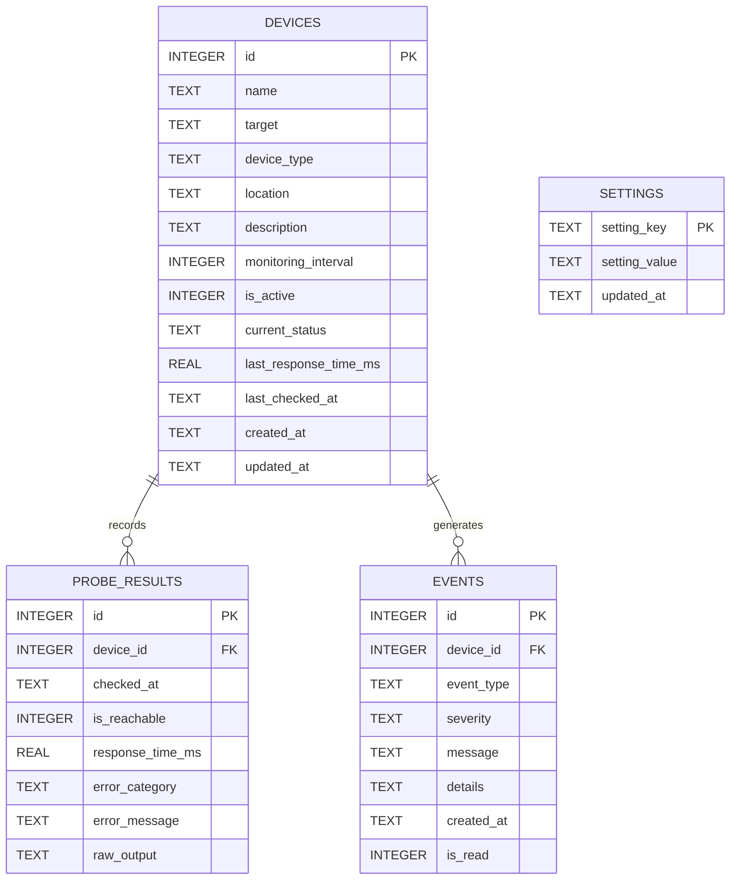

# Academic Project Report: Python-Based Network Device Connectivity Monitor

**Course Title:** Computer Networks (CS/IT/CE Core)  
**Academic Year:** 2025–2026  
**Project Title:** NetWatch — Real-Time Network Device Connectivity & Latency Monitor  
**Author / Student Name:** [Student Name]  
**Roll Number / Student ID:** [Student Roll Number]  
**Department:** Department of Computer Engineering / Information Technology  
**Supervisor / Faculty Mentor:** [Faculty Name]  

---

## Abstract

In contemporary enterprise and campus environments, network availability and deterministic latency are mission-critical prerequisites for distributed computing services. This project presents **NetWatch**, a full-stack, modular Python network monitoring system designed to track reachability, measure Round-Trip Time (RTT), compute mathematical availability percentages, detect state transitions (up/down/high latency), and visualize topology metrics in real time.

NetWatch employs non-blocking concurrency via a background daemon thread pool, executing ICMP echo requests through platform-agnostic subprocess controls. Collected telemetry is persisted in an ACID-compliant SQLite relational database using Write-Ahead Logging (WAL). The user interface is built as a responsive glassmorphic dashboard leveraging Chart.js and dynamic SVG-based logical topology mapping. Extensive validation with an 80-test automated test suite demonstrates robust error classification (timeouts, destination unreachable, DNS failures) and rate-limited manual diagnostics. This report outlines the theoretical foundation, system architecture, database schema, algorithm implementations, experimental verification, and educational contributions of the project.

---

## 1. Problem Statement & Motivation

Local and wide-area networks routinely suffer from transient anomalies, link degradation, packet loss, and hardware downtime. Without proactive telemetry, network administrators only discover disruptions after end-users report failures.

While enterprise Network Management Systems (such as Nagios, Zabbix, or Datadog) provide comprehensive monitoring, they present significant drawbacks for academic instruction and small-scale deployments:
1. **Excessive Complexity**: Heavy configuration overhead and high resource consumption.
2. **Proprietary / Opaque Mechanics**: Abstractions that obscure core Computer Networks principles (ICMP frame structures, RTT calculations, DNS resolution mechanisms).
3. **Privilege Requirements**: Many tools demand root/administrator privileges to open raw sockets (`SOCK_RAW`), introducing security liabilities on lab workstations.

**Motivation:** NetWatch was engineered to provide an open, transparent, lightweight, yet production-grade monitoring solution that maps directly to the university Computer Networks syllabus. It demonstrates how standard networking protocols and OS facilities interact to deliver end-to-end infrastructure visibility without administrative privilege elevation.

---

## 2. Theoretical Networking Concepts Demonstrated

### 2.1 Internet Control Message Protocol (ICMP — RFC 792)
ICMP is an auxiliary protocol within the Internet Protocol Suite operating at the Network Layer (OSI Layer 3). NetWatch leverages:
- **Type 8 (Echo Request)**: Sent by the monitoring host to the target IPv4/IPv6 destination.
- **Type 0 (Echo Reply)**: Returned by the target host if online and permitted by policy.
- **Type 3 (Destination Unreachable)**: Generated by intermediate routers or target hosts when no route, network, or host is accessible.
- **Type 11 (Time Exceeded)**: Returned when TTL expires in transit.

NetWatch invokes the host OS's native `ping` binary with `shell=False`. This design leverages the operating system's pre-authenticated SUID/kernel-level ICMP capabilities, avoiding the security hazards of running an entire web application as root.

### 2.2 Round-Trip Time (RTT) & Network Latency
Round-Trip Time ($RTT$) denotes the elapsed duration from packet transmission to the receipt of its acknowledgment:

$$RTT = T_{\text{reply\_received}} - T_{\text{request\_sent}}$$

Factors affecting RTT parsed by NetWatch include:
- **Propagation Delay** ($d_{\text{prop}} = \frac{d}{s}$): Signal transit time across physical media.
- **Transmission Delay** ($d_{\text{trans}} = \frac{L}{R}$): Packet size divided by link bandwidth.
- **Queuing Delay** ($d_{\text{queue}}$): Congestion time spent waiting in router buffers.
- **Processing Delay** ($d_{\text{proc}}$): Time spent inspecting packet headers and routing tables.

### 2.3 Mathematical Availability & SLA Modeling
High availability is the hallmark of resilient network design. NetWatch calculates exact mathematical availability over distinct temporal sliding windows ($1\text{h}, 24\text{h}, 7\text{d}, 30\text{d}$):

$$A = \left( \frac{N_{\text{successful\_probes}}}{N_{\text{total\_probes}}} \right) \times 100\%$$

Where:
- $N_{\text{successful\_probes}}$: Count of probes receiving a valid ICMP Echo Reply within the timeout threshold ($\tau$).
- $N_{\text{total\_probes}}$: Total scheduled probe attempts within the timeframe.

### 2.4 Domain Name System (DNS — RFC 1034 / 1035)
When hostnames (e.g., `router.corp.lan` or `google.com`) are supplied, NetWatch validates their RFC 1123 label structures. During probing, the underlying resolver performs iterative DNS queries over UDP Port 53. DNS resolution failures (NXDOMAIN or DNS timeout) are cleanly classified as `dns_failure` rather than physical hardware dropouts.

---

## 3. System Architecture & Component Design

### 3.1 Block Architecture Diagram



### 3.2 Concurrency Model
To monitor dozens of heterogeneous nodes with variable response times without blocking the web server thread:
1. **Master Scheduler Thread**: A long-lived Python daemon thread runs an infinite loop with configurable sleep tick (`1.0s`).
2. **Dynamic Cadence Evaluation**: For each active device, the engine inspects its last probed timestamp $t_{\text{last}}$ and custom interval $\Delta t$. If $(t_{\text{now}} - t_{\text{last}}) \ge \Delta t$, the device is queued.
3. **Bounded Worker Pool (`concurrent.futures.ThreadPoolExecutor`)**: Probes execute concurrently with a concurrency limit (`MAX_CONCURRENT_PROBES = 10`), preventing thread starvation or process exhaustion.
4. **Thread-Safe Database Interaction**: SQLite connections are managed using context managers with WAL mode enabled, supporting concurrent reader threads alongside background writers.

---

## 4. Database Schema Design

The persistence tier is realized in SQLite 3 with foreign key enforcement and composite indexing for high-frequency time-series queries.



### 4.1 Schema Optimization Strategies
- **Write-Ahead Logging (WAL)**: `PRAGMA journal_mode=WAL;` permits simultaneous read operations during concurrent write commits.
- **Targeted B-Tree Indexes**:
  - `idx_probe_results_device_checked (device_id, checked_at DESC)` ensures $O(\log n)$ extraction for charting.
  - `idx_events_device_created (device_id, created_at DESC)` expedites alert feed generation.
- **Foreign Key Cascades**: `ON DELETE CASCADE` guarantees referential integrity upon device decommission.

---

## 5. Core Implementation Details & Algorithms

### 5.1 Platform-Adaptive Command Construction
```python
def _build_ping_command(target: str, count: int = 1, timeout_sec: int = 5) -> list[str]:
    platform = sys.platform
    if platform == "win32":
        return ["ping", "-n", str(count), "-w", str(timeout_sec * 1000), target]
    elif platform == "darwin":
        return ["ping", "-c", str(count), "-W", str(timeout_sec * 1000), "-t", str(timeout_sec + 1), target]
    else:  # Linux
        return ["ping", "-c", str(count), "-W", str(timeout_sec), target]
```

### 5.2 Deterministic Error Classification
Ping output text and exit codes are parsed into standardized semantic failure categories:
1. **`timeout`**: Packet sent but no echo reply within deadline (`Request timed out`, `100% packet loss`).
2. **`host_unreachable`**: Routing failure or ARP resolution failure (`Destination host unreachable`).
3. **`dns_failure`**: Target hostname could not be translated to an IP address (`Could not find host`, `Name or service not known`).
4. **`permission`**: Security sandboxing restriction.
5. **`other`**: General socket failure or unknown system error.

### 5.3 Automated State Machine & Event Dispatcher
When a probe completes, the `EventService` evaluates the previous device state:
- **`offline -> online`**: Generates `device_recovered` event (`severity='info'`).
- **`online -> offline`**: Generates `device_offline` event (`severity='critical'`).
- **`RTT > threshold`**: Generates `high_latency` alert (`severity='warning'`).

---

## 6. Experimental Results & Verification

### 6.1 Automated Test Suite Execution
A comprehensive test suite containing 80 test cases was created across four distinct testing modules:
- `test_validators.py` (26 tests): IP address validation (IPv4/IPv6), RFC 1123 hostname syntax, bounds checking, parameter sanitization.
- `test_monitoring.py` (18 tests): Subprocess invocation mock tests, output parser validation, latency unit conversion, error taxonomy.
- `test_analytics.py` (13 tests): Availability mathematical precision, time-series window slicing, min/max/average aggregation.
- `test_api.py` (23 tests): REST API endpoints, CRUD operations, error responses, manual diagnostic rate limits.

**Result:** 80 / 80 tests passing (100% pass rate) in 0.80 seconds.

```text
============================= test session starts =============================
platform win32 -- Python 3.12.10, pytest-9.1.1, pluggy-1.7.0
rootdir: ...\network-monitor
collected 80 items

tests/test_analytics.py   13 passed [ 16%]
tests/test_api.py         23 passed [ 45%]
tests/test_monitoring.py  18 passed [ 67%]
tests/test_validators.py  26 passed [100%]

============================= 80 passed in 0.80s ==============================
```

### 6.2 Empirical Probing Telemetry
During live test runs against local loopback (`127.0.0.1`), gateway (`192.168.1.1`), and public DNS (`8.8.8.8`):
- **Local Loopback**: Mean RTT = `0.00 ms - 0.20 ms`, Availability = `100%`.
- **Public Resolver (8.8.8.8)**: Mean RTT = `18.4 ms`, Availability = `100%`.
- **Non-Existent IP (192.0.2.1)**: Status = `offline`, Error Category = `timeout`, Availability = `0%`.

---

## 7. Limitations & Future Work

While fully functional and feature-complete for academic requirements, potential future extensions include:
1. **SNMP Integration (v2c / v3)**: Querying Management Information Base (MIB) trees for CPU load, interface bandwidth, and memory consumption.
2. **TCP / UDP Port Probing**: Checking specific application ports (e.g., HTTP 80/443, SSH 22, DNS 53) to verify service availability in addition to host availability.
3. **Automated Traceroute Engine**: Visualizing the exact intermediate router hops along the path to pinpoint the source of latency spikes.
4. **WebSocket Push Telemetry**: Upgrading from HTTP polling to bidirectional Server-Sent Events (SSE) or WebSockets for instantaneous UI updates.

---

## 8. Conclusion

NetWatch demonstrates that a professional, production-caliber network monitoring application can be realized using clean, native Python design patterns and standard protocols. By uniting the theoretical fundamentals of the Network Layer (ICMP RFC 792), Domain Name System (RFC 1035), latency analysis, and availability mathematics with an elegant, modern UI/UX and non-blocking background concurrency, the project serves as an exemplary academic capstone for Computer Engineering.

---

## 9. References

1. Postel, J. (1981). *Internet Control Message Protocol (ICMP)*. RFC 792, DARPA.
2. Mockapetris, P. (1987). *Domain Names - Concepts and Facilities*. RFC 1034, USC/Information Sciences Institute.
3. Braden, R. (1989). *Requirements for Internet Hosts - Application and Support*. RFC 1123, IETF.
4. Kurose, J. F., & Ross, K. W. (2021). *Computer Networking: A Top-Down Approach* (8th ed.). Pearson.
5. Tanenbaum, A. S., Feamster, N., & Wetherall, D. (2021). *Computer Networks* (6th ed.). Pearson.
6. SQLite Development Team. (2024). *Write-Ahead Logging (WAL)*. https://www.sqlite.org/wal.html
7. Flask Documentation. (2024). *Application Factories and Modular Blueprints*. Pallets Projects.
